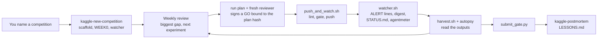

# ML Agent Harness: a Claude Code agent for Kaggle, with code-enforced gates
[](https://github.com/juliversa/ml-agent-harness/actions/workflows/ci.yml)

I built this harness to run Claude Code as a solo Kaggle competitor. Its core idea: when a written rule failed to stop a mistake and a check was possible, I turned the rule into code. Scripts refuse GPU pushes and submissions until their checks pass, hooks block the direct CLI calls, and a watcher with no LLM raises alerts the agent must acknowledge.

Kaggle, with earlier versions of this agent and my steering: silver (125th of 6,191) and two bronzes across five competitions of about 3,500–6,425 teams. This version is built from their failures and has not yet run a full competition; `examples/` replays two of them through it.

- **How you use it:** join a competition on kaggle.com, run `claude` in this repo and type `Join <slug>, deadline YYYY-MM-DD`. The agent scaffolds `competitions/<slug>/`, trains, and can push or submit only through the `kit/` scripts; you answer only a short list of owner decisions ([Quickstart](#quickstart)).
- 127 offline tests run in CI; `bash tests/demo.sh` shows the gates refusing in seconds, with no Kaggle login.
- Guard rails, not a sandbox: run the agent in a container or VM (this one ran in Docker).
- Numbers that are not in `examples/` come from my private competition records.

## What I learned running an agent on Kaggle
Details and sources for each: `LESSONS.md`.
- **Ask whether a change helps everywhere or only on the hard tail; the public board may not show it.** On ROGII (lower is better) a confidence gate that acted only on the hard wells cut private error from 8.488 to 7.866 while the public board barely moved; the private split held the harder wells.
- **My agent team cost more than it shipped.** A manager + 4 workers spent 44 % of their (price-weighted) token spend on coordination (a TPU queue also blocked) and submitted nothing in 2.9 days; one lead with one-shot helpers used under half the tokens a day (36 vs 78 M) and resumed submitting. Not a controlled test: the cheapest week (16 M a day, solo) gave the largest gain.
- **Context is the real cost.** The solo lead's median context was 324k tokens a turn, and cache reads of that context were 63 % of spend. Now, past a context limit a Stop hook sends the lead back to write its handoff; the next session starts from STATE/NOW.
- **On RSNA, a 58-exam expert-labelled set did not track the public board** (rank correlation .07 over 13 subs, vs .79 for fold-0 out-of-fold AUC). CV is now trusted to rank only while public scores rise with CV and stay close to a straight line fitted on it.

## See it work (no Kaggle login)
`bash tests/demo.sh` runs the gates and one watcher pass against a fake Kaggle CLI and a throwaway competition. The 'ruler' alert checks that the public score rises with CV at least half as fast and stays close to its straight-line fit (`PLAYBOOK.md`). An excerpt (paths shortened):
```text
▸ GPU push whose 'Verdict: GO' is not bound to the plan text (kit/push_and_watch.sh)
REFUSING: GPU/TPU push: last Verdict in comps/demo/plans/k1.md is not GO for this plan's hash (plan edited after review?); expected 'Verdict: GO sha256=103c16ff9169e7f9'
▸ The reviewer signs the plan as it stands (hash of its text); push again
[push] me/k1 v7 registered in comps/demo/kernels.txt + events.log; watcher.sh alerts in events.log on complete/error
▸ Finished kernels nobody read yet (kit/harvest_check.sh)
Checked 1 kernels; 1 UNHARVESTED, 0 unreadable.
▸ A submission file with a missing value (kit/submit_gate.py)
  ABORT: 1 rows with missing/NaN values, first at line 3
▸ One watcher pass with nine 5-fold subs whose public score falls as CV rises
tier 1 (events.log; the Stop hook sends the agent back to ack them):
  ALERT [k-me_k1-complete] kernel me/k1 complete
  ALERT [ruler-…] ruler: CV vs public over 9 subs: slope -0.47 (CV rises while the public score falls)
  ALERT [noerr-e9] noerr: rows e1 e2 e3 e4 e5 e6 e7 e8 e9 have oof_mean but no eda/err-<id>.md: run skill autopsy on each (…)
… (ack flow: see `tests/demo.sh`)
```

## Competitions behind it
| competition (task, teams) | result | key number | what I built |
|---|---|---|---|
| ROGII (well-log alignment, 6,191) | silver, 125th | hard-well gate, −0.622 private (above) | Particle filter aligning gamma-ray logs; confidence gate that switches to the well's own log where it fits better; code: [kaggle_geosteer](https://github.com/juliversa/kaggle_geosteer) |
| BioHub (3-D cell tracking, 4,020) | bronze, 355th | the only late change that gained on private | One ILP linker on a public 3-D U-Net detector, replay-validated on unseen embryos |
| RSNA knee (MRI, 12 findings, 6,425) | bronze, private AUC .943 | CV ranked all 4 finals in private order; own models only | ConvNeXt-T, per-finding attention; LLM report labels + image teacher; scanner-held-out folds |

Also: BirdCLEF+ (own HGNet SED model; Perch + ProtoSSM + SED ensemble) and an LLM maths-reasoning competition (gpt-oss-120b served with vLLM, tool-integrated reasoning, inverse-entropy voting), no medal.

## Replay: what today's checks would have caught
Two finished competitions' records, replayed day by day through today's watcher (`examples/replay.py`). Each day sees only what was on record that day: numbers learned later enter on their own date. It shows what would have been flagged, not what would have been won. Full table: `examples/README.md`.

| what went wrong | the check | when it would have fired |
|---|---|---|
| RSNA: most "kept" changes were scored on one fold | the adoption bar reads them as screens (rank only), not kept | from the first row, 10-01 |
| RSNA: three submissions were logged with no CV, so the log's best CV stood still for a week | progress check: 7 days flat | 10-14, 2 days before the team's own audit |
| RSNA: public scores scattered around the CV line (.0094 > 1.5 × LB noise) | CV-vs-public check | 10-16, the same day as the team's own audit: no earlier warning |
| ROGII: best CV flat for 11 days while the winners' method sat unbuilt in our notes | progress check: 7 days flat | 07-31, 5 days before the deadline |
| ROGII: LB noise was never measured during the competition | CV-vs-public check: "LB noise not measured" | 08-05, the deadline day: a week-0 job, too late |


## Failure observed → control now in place
Evidence for each row: `LESSONS.md`; rules: `RULES.md`; method: `PLAYBOOK.md`; terms: `GLOSSARY.md`.

| what went wrong in a real competition | the control now in place | enforced by |
|---|---|---|
| 5-agent team: 0 submissions in 2.9 days (above) | one lead decides; short-lived parallel workers never talk to each other; a fresh reviewer signs each GPU plan (one per kernel; the GO lasts 24 h) | tool: `kit/fanout.py`; code: `kit/push_and_watch.sh` (GO bound to the plan hash) |
| Asking the owner to approve each GPU run separately left 26 of 30 weekly GPU-hours idle | the free quota is a standing weekly budget; an alert flags an idle GPU | written rule; code: `kit/watcher.sh` (alert) |
| On ROGII (lower is better), in the 11 days after v27 (07-24), other changes cut private error by 0.189 while the best public score moved 0.003 | progress is read on CV, never on the public board; the watcher's plateau alert flags a stall | method; code: `kit/watcher.sh` (alert) |
| Ideas were closed on cheap tests that later proved to be the winners' biggest lever | an idea is closed only after its strongest version has run on all folds, never on a quick probe | written rule; code: `kit/push_and_watch.sh` (a lever run needs an elite-spec file naming that version) |
| RSNA: a 58-exam expert set did not track the public board over 13 submissions (above) | CV is trusted to rank only while public scores keep tracking it on a rising line; the watcher flags a break | method; code: `kit/watcher.sh` (alert) |

## What the code does
Each part, where it lives, and its honest limit.
- **GPU gate** (`kit/push_and_watch.sh`). A fresh reviewer signs a GO bound to the plan's hash (sha256 of the plan without its Verdict lines), so any edit after review voids it. It also wants a plan signed in the last 24 h, a saved sample batch (> 1 KB) and, for a big idea, a file describing its strongest version. Kaggle CLI options pass through an allow-list (the CLI accepts prefixes such as `--pa` for `--path`). Limit: the GO binds the text, not who wrote it (no separate reviewer key).
- **Submit gate** (`kit/submit_gate.py`). Refuses a submission without a CV number (or a stated reason), over 5 a day, with a repeated description, or without a finished kernel with a clean log (code competitions) or a file matching the sample (file competitions). Unreadable input means refuse.
- **Hooks** (`kit/hooks/`). Block direct `kaggle kernels push` / `competitions submit`, destructive deletes, making anything public, whole reads of files > 40 KB and helper briefs missing the coding rules; send the agent back once on unacked urgent alerts; ask for a handoff past 150k tokens of context. `guard_command.py` has one named check per blocked action behind `check(cmd)`. Limit: guard rails, not a sandbox; regexes stop the direct shortcuts and the gate scripts are the real control, so run the agent in a container.
- **Watcher, no LLM** (`kit/watcher.sh`, checks in `kit/exps.py`). Every 5 minutes, 16 kinds of alert: kernel done or failed, idle GPU, token budget, slow progress, CV and public board disagreeing, a stuck lead (table below), and more. Urgent alerts land in `events.log`; the Stop hook sends the agent back once per stop until each is acked (`kit/ack.sh`). The step-back alerts, `ruler` and `plateau` fire once per state, day or week, not every 3 h, so acks stay meaningful; stepback and loop, which ask for a new angle, go quiet at the day −10 freeze. It rewrites `STATUS.md` and meters tokens, context and cost per finding (`kit/agentmeter.py`).
- **Keeper, from cron** (`kit/keeper.py`). Restarts a dead watcher or a stuck lead within the token budget and stops after two restarts that made no progress; a few push notifications a day (ntfy).
- **Arm vs control** (`kit/compare.py`). Per-fold Δ and the Nadeau–Bengio corrected t: B is read as above its control only if t ≥ 2, no fold is negative and pooled Δ ≥ 0. Once seed noise is measured, `--bootstrap` reads instead on a paired group bootstrap of the pooled Δ plus that training noise; in simulation it false-passes less than the fold bar and catches more true gains while training noise is small. It also prints Δ on a frozen hard slice. Limit: a screening bar, not a significance test; `kit/sim_bar.py` measures what it misses (a one-fold-SD gain passes about 1 in 3) and how often it false-passes.
- **Step-back alerts** (urgent; the watcher, checks in `kit/exps.py`). A working lead that stops making progress is sent back to the data:

  | alert | fires when | what the agent does |
  |---|---|---|
  | `stuck-time` | `FINDINGS.md` unchanged for 3 h (again every 12 h) while > 1M tokens were spent and no kernel runs | skill `autopsy` on the latest scored run (20 worst, 10 clean, 10 random items); before the first, hand-read raw items |
  | `stuck-tokens` | every 5M tokens since `FINDINGS.md` last changed | the same |
  | `loop` | one mechanism failed 3 times since its last kept change (each no better than its parent's CV) | next run is a new angle at a lower level: data, labels, metric, loss |
  | `noerr` | a kept or lever row has a CV but no `eda/err-<id>.md` (daily until it exists) | read that run's failing items (skill `autopsy`) |
  | `stepback` | no `intel/stepback-<date>.md` in 72 h | write one: the biggest untried lever and one thing no top-10 team uses |

  The keeper does not restart an idle lead for `stuck-*`; they are about a lead that is working. Limits: tokens are price-weighted and counted over all Claude projects on the account (the usage limit is account-wide), so run one lead per account; `noerr` checks that the file exists, not that it was read; an ack takes any reason.
- **Tests** (`tests/`). Offline against a fake Kaggle CLI (`tests/bin/`): gate refusals, hook blocks, watcher alerts, the statistics, the replays, and the docs' own IDs and counts.

## How it works


## Quickstart
Needs Linux or WSL (GNU coreutils, flock), python3, the [Kaggle CLI](https://github.com/Kaggle/kaggle-api) 2.x (logged in) and [Claude Code](https://claude.com/claude-code). Run it inside a container or VM: the hooks are guard rails, not a sandbox.
"The owner" in the docs is you. The agent asks you only: join a competition · go over the compute or token budget · keep or drop one of its own constraints · switch to budget mode (fewer folds per idea) · spend real money · anything public or irreversible · the two final submissions (`RULES.md`).
Make a private copy (fork or clone into a private repo) before the first competition: competition records are committed.
```sh
# from a clone of this repo:
python3 -m venv .venv && . .venv/bin/activate && pip install numpy matplotlib 'kaggle>=2,<3'
kaggle --version                                                     # check: prints "Kaggle CLI 2.x"
mkdir -p .claude && ln -s ../skills .claude/skills && cp kit/settings.example.json .claude/settings.json
export KAGGLE_USER=<your kaggle username> OWNER_TZ=<IANA zone, e.g. Europe/Berlin>
python3 -m unittest discover -s tests && bash tests/demo.sh           # offline, fake Kaggle CLI
PATH=$PWD/tests/bin:$PATH COMP_ROOT=/tmp/try bash kit/setup-competition.sh my-test "My test" 2030-01-01   # optional dry run, no login; kill the watcher PID it prints
claude
```
Join a competition on kaggle.com (accept its rules), then tell the agent: `Join <competition-slug>, deadline YYYY-MM-DD`.
On a machine where you already use Claude Code, the first watcher pass may raise `ALERT [budget]`: it counts every transcript in `~/.claude/projects`, since the usage limit is per account. Raise `TOKEN_ALERT_M` or ack it once: `COMP_SLUG=<slug> bash kit/ack.sh budget "usage from before this harness"`.
It runs `kit/setup-competition.sh`, which creates `competitions/<slug>/` with its records (committed; data, weights and run outputs are git-ignored, except logs and .txt/.json/.md files under runs/) and starts the watcher.

### Optional: keeper and notifications
So a stopped lead does not wait for you, run the keeper from cron every 2 h (use absolute paths; put `.venv/bin` in the keeper's cron PATH; set `NTFY_TOPIC` to get ntfy push notifications):
`0 */2 * * * PATH=<dir of kaggle and claude>:/usr/bin:/bin NTFY_TOPIC=<your topic> KAGGLE_USER=<your kaggle username> OWNER_TZ=<zone> CLAUDE_BIN=<path to claude> python3 <repo>/kit/keeper.py >> ~/keeper-cron.log 2>&1`
Permissions and hooks are in `kit/settings.example.json`; `.claude/` (your `settings.json` copy and the skills link) is local to each clone, and `.claude/settings.json` is git-ignored. Token budget alert: `TOKEN_ALERT_M=<M>` in the watcher's environment (default 45, million weighted tokens a day, `RULES.md`). Stop a watcher with `kill <PID>` (the scaffold prints it).

## Repo map
| path | what |
|---|---|
| `CLAUDE.md` | the agent's boot order |
| `RULES.md` | the operating contract between owner and agent; rules cite the lesson behind them |
| `PLAYBOOK.md` | the method: a weekly review loop, a week-by-week plan, 14 rules of thumb (laws), the records the watcher reads |
| `GLOSSARY.md` | the terms used across the docs, in plain English |
| `LESSONS.md` | five competitions compared with winners' or top-team write-ups (one from the forum); 35 lessons (25 in the table + a 10-item checklist); priors by problem type |
| `TOOLING.md` | 27 Kaggle and compute traps, symptom → fix |
| `skills/` | the agent's procedures: run, submit, `red-team-run` (signs the GO), `hostile-review`, autopsy, post-mortem, `explainer-video`, and others |
| `kit/` | the code above: gates, watcher + `ack.sh`, hooks, `compare.py`, `exps.py`, `agentmeter.py`, `keeper.py`, `fanout.py`, `pick_items.py`, `sim_bar.py`; also harvest, linters, `graphs.py`, templates, the scaffold, the video engine |
| `tests/` | offline tests of the gates, watcher and hooks; `demo.sh` |

## License
MIT, see `LICENSE`. Snapshot of October 2026.
